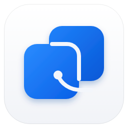
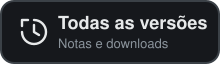
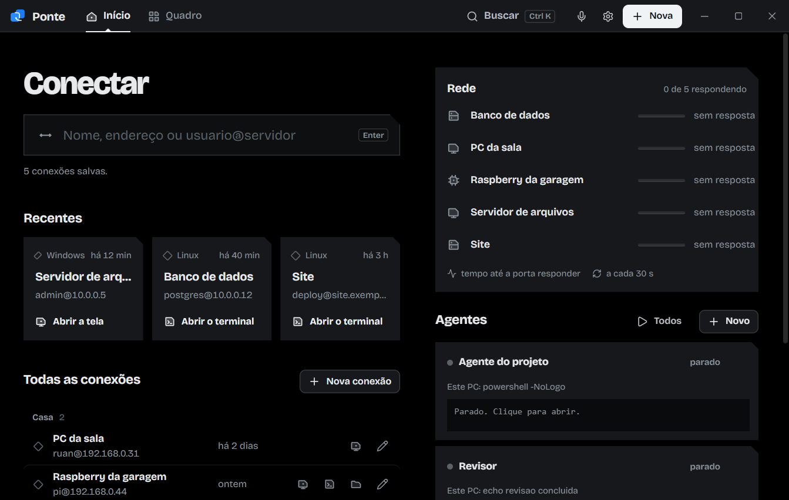
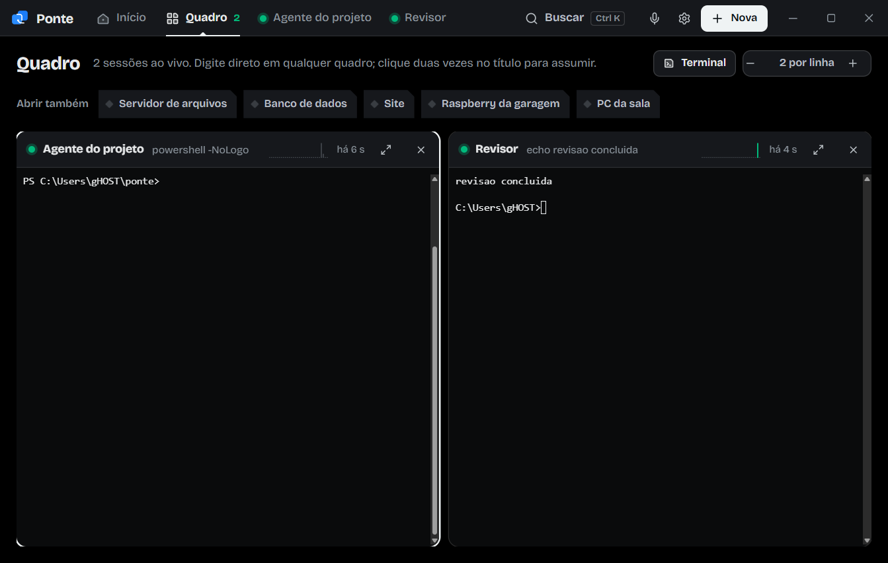

<div align="center">



# Ponte — Remote Desktop Management

Suas máquinas Windows e Linux e seus agentes de IA num app só.<br>
Área de trabalho remota, terminal e arquivos na mesma conexão, sem barra lateral ocupando a tela.


<a href="https://github.com/tenk-rgb/ponte/releases/download/v1.8.0-beta/Ponte-Setup.exe"></a>
&nbsp;
<a href="https://github.com/tenk-rgb/ponte/releases"></a>

</div>

> [!WARNING]
> **Versão beta.** O Ponte já é usado no dia a dia, mas ainda pode ter falhas. Faça um backup das suas conexões em **Ajustes › Exportar** e conte o que encontrar em [Issues](https://github.com/tenk-rgb/ponte/issues).

<br>

<p align="center">
  
</p>

## Sumário

- [Instalar](#instalar)
- [Primeiros passos](#primeiros-passos)
- [O que dá para fazer](#o-que-dá-para-fazer)
- [Atalhos de teclado](#atalhos-de-teclado)
- [Perguntas frequentes](#perguntas-frequentes)
- [Versões](#versões)
- [Para desenvolvedores](#para-desenvolvedores)

## Instalar

1. Clique em **Baixar para Windows** acima.
2. Abra o arquivo `Ponte-Setup.exe`.
3. Se o Windows mostrar **"O Windows protegeu o computador"**, clique em **Mais informações** e depois em **Executar assim mesmo**. O aviso aparece porque o instalador ainda não tem assinatura digital, o que é comum em versões beta.
4. Avance até o fim. O Ponte instala só para o seu usuário e **não pede senha de administrador**.

| Requisito | |
|---|---|
| Sistema | Windows 10 ou 11, 64 bits |
| Espaço | cerca de 150 MB |
| Internet | só para conectar às suas máquinas; o app não envia nada para fora |

Para atualizar, baixe a versão nova e instale por cima. Suas conexões continuam salvas.

## Primeiros passos

**1. Salve uma máquina.** Clique em **Nova** (ou `Ctrl+N`). Preencha nome, sistema (Windows ou Linux), endereço, usuário e senha. Portas e o resto ficam em "Mais opções" e já vêm preenchidos.

**2. Conecte.** No campo **Conectar**, digite o nome ou o endereço e aperte `Enter`. Se o endereço ainda não estiver salvo, o formulário abre já preenchido.

**3. Use as abas da conexão.** Cada máquina abre numa aba com até três visões:

| Visão | Para quê |
|---|---|
| **Tela** | A área de trabalho remota, dentro da janela do app |
| **Terminal** | Linha de comando na máquina (Linux, ou Windows com SSH) |
| **Arquivos** | Navegar, enviar, baixar, renomear e apagar arquivos. Arraste arquivos do seu PC para enviar |

**4. Acompanhe tudo no Quadro.** A aba **Quadro** mostra todas as sessões abertas lado a lado, ao vivo.

## O que dá para fazer

- **Área de trabalho remota** de máquinas Windows e Linux, sem abrir outra janela.
- **Terminal e arquivos na mesma conexão Linux**, com arrastar e soltar do seu PC para o servidor.
- **Agentes de IA e terminais** rodando no seu PC ou num servidor Linux. Cada agente mostra as últimas linhas no Início; no Quadro dá para digitar em qualquer um.
- **Painel Rede**, que mostra quais máquinas estão respondendo e em quantos milissegundos.
- **Grupos recolhíveis**: com muitas máquinas, cada grupo vira uma linha de resumo (quantas máquinas, quantas online e offline, latência média). Clique para abrir.
- **Busca rápida** com `Ctrl+K` para achar qualquer conexão, agente ou ação.
- **Ditado por voz**: clique no microfone e fale; o texto vai para o terminal.
- **Backup**: exporte e importe todas as conexões e agentes em **Ajustes**.
- **Tema claro e escuro**, seguindo o Windows.

<p align="center">
  
</p>

## Atalhos de teclado

| Atalho | Ação |
|---|---|
| `Ctrl+K` | Buscar conexão, agente ou ação |
| `Ctrl+N` | Nova conexão |
| `Ctrl+1` / `Ctrl+2` | Ir para Início / Quadro |
| `Ctrl+3` em diante | Ir para cada aba aberta |
| `Ctrl+Tab` | Próxima aba |
| `Ctrl+Shift+W` | Fechar a aba atual |
| `Ctrl` + roda do mouse | Afastar ou aproximar o Quadro |

## Perguntas frequentes

<details>
<summary><b>Onde ficam minhas senhas?</b></summary>
<br>
No seu computador, em <code>%APPDATA%\Ponte</code>, criptografadas e presas ao seu usuário do Windows. Ninguém mais consegue abri-las, nem copiando o arquivo para outro PC.
</details>

<details>
<summary><b>Uma máquina aparece como "sem resposta". Por quê?</b></summary>
<br>
O Ponte testa a porta de cada máquina a cada 30 segundos. Se ela fica numa VPN ou rede da empresa, conecte essa rede primeiro. Também vale conferir se a máquina está ligada e se a porta (RDP 3389, SSH 22) está liberada no firewall.
</details>

<details>
<summary><b>O ditado por voz não funciona.</b></summary>
<br>
Ligue <b>Reconhecimento de fala online</b> em Configurações do Windows › Privacidade e segurança › Fala, e permita o uso do microfone por aplicativos da área de trabalho.
</details>

<details>
<summary><b>Apareceu um aviso de certificado ao conectar numa máquina Windows.</b></summary>
<br>
É normal na primeira conexão com servidores que usam certificado próprio. Confira se o nome da máquina está certo e aceite.
</details>

<details>
<summary><b>Como levo minhas conexões para outro computador?</b></summary>
<br>
Em <b>Ajustes › Exportar</b> você gera um backup <code>.json</code>. No outro PC, use <b>Ajustes › Importar configurações</b>. As senhas precisam ser digitadas de novo, porque ficam presas ao usuário do Windows de origem.
</details>

## Versões

| Versão | Data | Novidades |
|---|---|---|
| **1.8.0 beta** | 21/10/2026 | Grupos recolhíveis na lista e no painel Rede, com resumo de máquinas, online, offline e latência média. |
| 1.7.0 beta | 21/10/2026 | Primeira versão pública. Logo nova, importar e exportar configurações, Quadro com atividade ao vivo, painel Rede com latência, visual preto e cinza. |

Todas as versões e instaladores estão na página de [Releases](https://github.com/tenk-rgb/ponte/releases).

## Para desenvolvedores

Requer o .NET 10 SDK e o Inno Setup 6.

```powershell
git clone https://github.com/tenk-rgb/ponte.git
cd ponte
.\build.ps1          # gera artifacts\Ponte-Setup-<versão>.exe
```

Para rodar sem instalar: `dotnet run --project src\Ponte`.

## Licença

[MIT](LICENSE) © 2026 Ruan Rodrigues Fermino
